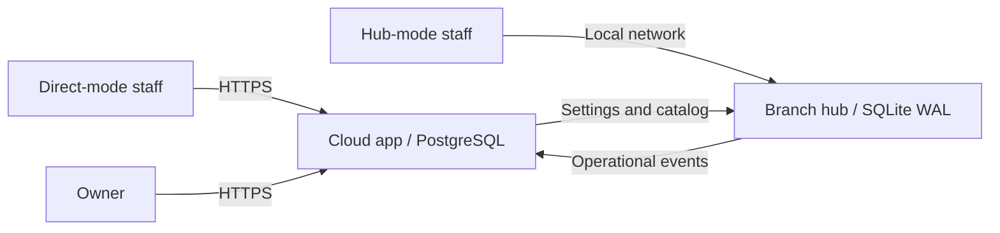

# Washday

Washday is a laundry-shop operations app for Ivan & Ivy Laundry. It brings counter intake, job tracking, machine loads, payments, and supplies into one workflow across branches. Staff record the work as it happens, while an immutable event history keeps jobs, collections, and stock auditable.

The application uses **Python 3.13, Django 6, server-rendered templates, and HTMX**.Prices are calculated on the server, money is stored as decimals, and business dates use **Asia/Manila**. Fonts, icons, and branding are served locally.

**Current status:** the counter, job board, history, machine, and supply workflows are implemented for local development. Google owner sign-in, enrolled devices, staff sessions, shared-device PINs, and minimal staff/device administration are now available for local testing. The owner dashboard, read-only live branches, staff/machine administration, catalog settings and Excel collection reports are available. Six-second compensating Undo, the hub/cloud split and durable offline replication are implemented; physical rollout qualification and an approved BIR export layout remain pending. See [Undo and offline replication](docs/offline-and-undo.md). The deployment sections below explain the intended architecture and rollout; this checkout is not yet a production release.

## Branch management

Owner → **Branches** opens **Live Branches**, the existing watch-only screen with its 20-second refresh. Switch to **Manage Branches** to add a branch or edit its name, unique code, hours and simple/full workflow. The selected live branch also has an **Edit branch** shortcut. Branch hours and workflow are managed here; Settings and Access and devices no longer duplicate these forms.

New branches start with Direct connection and Simple workflow. Internal numbering is allocated automatically and cannot be changed in the editor. Connection mode is shown read-only until safe hub migration is implemented. Unload running machines before changing a full branch to simple workflow. Branch changes update the shared settings version and append an owner audit event.

## Contents

- [UI audit and before/after screenshots](docs/ui-audit/README.md)
- [Core features](#core-features)
- [Direct, hub, simple, and full modes](#direct-hub-simple-and-full-modes)
- [Local development](#local-development)
- [Configuration](#configuration)
- [Tests and browser checks](#tests-and-browser-checks)
- [Direct-mode deployment](#direct-mode-deployment)
- [Hub-mode deployment](#hub-mode-deployment)
- [Project layout and references](#project-layout-and-references)

## Core features

| Feature | Available behavior |
| --- | --- |
| Counter intake | Clothes priced per kilogram or load, fixed-price pieces by size, mixed jobs, add-ons, fees, optional customer lookup/create, notes, and a live server-computed summary. Existing jobs retain their original price lines. |
| Payments and claim stubs | Cash, GCash with an optional reference, or payment at claim; digital claim stubs and the device's print dialog. A paid job is not collected twice. |
| Job board | Independent Next/Claim actions, simple/full stage flows, manual corrections, and stale-action refusal when another device has already moved a job. |
| Paper reconciliation | P numbers, original received/payment/release times, duplicate detection, and app-versus-written totals. Paper jobs appear on their actual business dates. |
| List, History, and timelines | Search across dates by job/P number, customer, phone, notes, status, or payment; inspect stage changes, actors, machine activity, collections, and releases. |
| Machines | Start job-linked loads **from the Jobs board**. Use Machines primarily to monitor elapsed time/current jobs and unload machines. Paid self-service is available for loads without a drop-off job. Busy and out-of-service machines cannot accept a load. |
| Supplies | Ledger-based stock, automatic add-on/washer-load/first-Ready usage, receipts, full and partial counts, variance and low-stock indicators, supply requests, and permission-gated type creation. |
| Data and interface | Shop-scoped records, branch job numbers, transactional state/event writes, immutable historical records, responsive light/dark screens, and a theme preference saved per device. |

Owners can now sign in with an allow-listed Google account and manage staff access, device setup/revocation, branch hours, and shared-device PIN rules. Enrolled personal phones sign in for 24 hours and open Jobs in both modes; shared tablets start at New job. The owner workspace now includes Dashboard, Live branches, Staff, Machines, Settings and Access and devices. Daily collections can be exported to Excel; a prescribed BIR layout and physical rollout qualification remain later work. Undo and hub replication are described in [the operator guide](docs/offline-and-undo.md). See the [outcome plan](outcomes/washday-mvp/README.md) for their scope and dependencies.

## Owner impersonation for support

On the cloud app, create an operator account with `uv run python manage.py createsuperuser`
and sign in at `/washday-admin/`. In **Users**, use the built-in **HIJACK** button to
impersonate an active linked owner. Only superusers can impersonate users; staff
status alone does not grant this permission. The owner workspace opens with the
impersonated user's shop access. The standard visible django-hijack banner includes
**stop impersonating**, which restores the operator session.

`allow_owner` creates an allow-listed `ShopOwner` only. The owner must complete their
first Google sign-in to create/link their Django user before appearing in the admin
user list. Inactive owners and archived shops retain their normal access restrictions.
Impersonation does not grant a staff/device identity. Admin and hijack routes are
unavailable on branch hubs.

The integration uses [django-hijack's standard installation and admin integration](https://django-hijack.readthedocs.io/en/stable/)
and its built-in superuser-only permission check. Version 3.7.9 supports this project's
Python 3.13 and Django 6.0; 3.8 requires Python 3.14.

## Direct, hub, simple, and full modes

There are two separate choices for each branch:

- **Direct or hub** determines where staff connect and whether work can continue during an internet outage.
- **Simple or full** determines the staff workflow. Simple mode hides Machines and skips hidden middle stages; full mode exposes the configured stages and machine pickers. Changing this setting preserves jobs' actual stages.

New branches default to **direct + simple**. Full mode does not mean hub mode.

The deployment architecture is as follows:

| | Direct mode | Hub mode |
| --- | --- | --- |
| Staff connect to | Cloud app over HTTPS | Branch hub over local Wi-Fi/LAN |
| Operational database | Cloud PostgreSQL | Hub SQLite in WAL mode on an SSD |
| Internet outage | Use paper sheets, then reconcile when service returns | Staff continue using the hub; queued events sync after reconnecting |
| Branch equipment | Tablet/phones and an internet-connected router | Tablet/phones, hub, router, and a UPS powering the hub and router |
| Owner access | Cloud app | Cloud app, with the latest synced branch data |



**The role split and replication protocol are implemented.** Use the [Undo/offline operator guide](docs/offline-and-undo.md) for bootstrap, authenticated sync, fencing, migration and verification. Changing `Branch.mode` directly is not a supported switch; simple/full mode remains a separate workflow setting. Physical release gates are still pending.

## Local development

### Prerequisites

- Git.
- [uv](https://docs.astral.sh/uv/getting-started/installation/) for Python and dependency management.
- Python **3.13**; uv can install it with the command below.
- For browser tests only: Node.js **24**, npm, and Chromium. Linux Cypress also needs Xvfb and its [system dependencies](https://docs.cypress.io/app/get-started/install-cypress#Linux-Prerequisites).

SQLite is included with Python, so the default setup needs no database server. Node.js is for browser testing; the app has no frontend build step.

### Test authentication with Google locally

Create a Google OAuth **Web application** client in Google Cloud. Configure its consent screen and add your Google account as a test user if the project is in Testing mode. Register this exact **Authorized redirect URI**:

```text
http://localhost:8000/accounts/google/login/callback/
```

Use `localhost` consistently throughout sign-in and setup; `127.0.0.1` is a different cookie origin. If you prefer that address, register its matching callback URI and use it consistently instead. The flow is server-side OAuth through django-allauth; the client secret is never sent to the browser.

From the cloned checkout:

```sh
uv python install 3.13
uv sync --locked
cp .env.example .env
```

Edit `.env` to set **`GOOGLE_CLIENT_ID`** and **`GOOGLE_CLIENT_SECRET`** from your Web application client. Then run:

```sh
uv run --env-file .env python manage.py migrate
uv run --env-file .env python manage.py seed_demo
uv run --env-file .env python manage.py allow_owner your-google-email@example.com --shop-code DEV-ONLY
uv run --env-file .env python manage.py runserver localhost:8000
```

Open [http://localhost:8000/owner/login/](http://localhost:8000/owner/login/) and choose **Continue with Google**. Only the verified Google email you allow-listed can sign in. The bootstrap command adds permission for an existing shop; it does not create a password or bypass Google authentication. Owner sessions last 14 days and the allow-list is checked on every owner request.

### Provision a production shop

After configuring the production environment and running `migrate`, create a shop without development fixtures:

```sh
uv run --env-file .env python manage.py create_shop
```

In a terminal, the command asks for the Shop code, name, minimum billable kilos, kilos per load, timezone (press Enter for `Asia/Manila`), and an optional owner Google email. Required answers cannot be blank. Cancelling a prompt saves nothing.

You can also supply flags, or mix flags with prompts for missing details:

```sh
uv run --env-file .env python manage.py create_shop \
  --shop-code MY-SHOP --name "My Laundry" --min-kg 3 --kg-per-load 7
```

Replace the example code, name and weight settings with the shop's actual values. `--shop-code` identifies the **Shop**, not a branch. The timezone defaults to `Asia/Manila`; set `--timezone` to another IANA timezone if needed. The command creates settings, Washer/Dryer categories and the Received → Washing → Drying → Folding → Ready workflow. It does not create demo prices, staff, stock or branches, and refuses to overwrite an existing shop (including an archived one).

At the end of setup, an interactive terminal prompts for the owner's Google email. Enter it to approve owner sign-in in the same command, or leave it blank to skip. For automation, supply all four shop flags shown above and add `--owner-email owner@example.com --noinput`; omit `--owner-email` to provision without an owner. Non-terminal runs never prompt, and missing required flags produce an error. Invalid input or an email already assigned to another shop rolls back the entire setup. If you skip the owner email, use `allow_owner EMAIL --shop-code MY-SHOP` later. Google OAuth still needs to be configured; this command creates no password or login session.

Sign in at `/owner/login/`, then use **Branches → Manage Branches** to add the first branch and its hours. Configure prices, machines, staff, devices and operational settings in the owner workspace before taking jobs. `seed_demo` remains development-only.

### Django administration

Django admin is available on the cloud service at `/washday-admin/`. It uses Django staff accounts and model permissions. To create the initial superuser inside the deployed container, run:

```sh
/app/.venv/bin/python manage.py migrate
/app/.venv/bin/python manage.py createsuperuser
```

For a local checkout, use `uv run python manage.py createsuperuser`. The admin provides Django's built-in user/group management and read-only inspection of all 34 application models: shops, branches, settings, owners, catalog, customers, jobs and price lines, machines and loads, staff, devices and shifts, supplies and stock history, and event/sync records. Application lists include shop filters and search. Superusers can inspect all shops; other staff need the relevant model's view permission, which also permits inspection across shops.

Application records cannot be added, edited or deleted through admin. Use the owner workspace, supported management commands or the existing impersonation flow for changes so that validation, audits, stock deductions and replication stay consistent. Credential hashes are hidden, including nested hashes in event, undo and sync JSON. Admin requests run without shop/device context and the admin is unavailable on branch hubs. Google owner approval alone does not grant admin access.

### Configure branch access

Open **Settings → Shop branding** in the owner workspace to edit the shop name and upload or clear a logo (PNG, JPEG or WebP, up to 2 MB). Shop branding appears on owner/staff headers and claim stubs once a shop is in context. Signed-out screens use WashDay and its generic icon. Uploaded files live in the Git-ignored `media/` directory; include this directory in backups and serve `/media/` through the web server when deploying. Django serves these files during local DEBUG development.

1. In **Access and devices**, set the DEMO branch's opening/closing times. Staff sessions last 24 hours from sign-in, independently of branch hours.
2. In **Staff**, choose a branch, add a staff member and enter a four-digit PIN, or leave it blank to generate one. The PIN is shown once and stored hashed. PINs are unique among active staff in a branch.
3. In **Access and devices**, create a **shared counter tablet** or **personal staff phone**. You receive an installation QR/link and a separate six-digit code. The code is shown once, expires after 15 minutes, and can be used once.
4. Open the installation link in another browser profile/private context to simulate a different device. On a phone, add it to the Home Screen, open the icon, and enter the code there. The explicit `DEVICE_SETUP_ALLOW_BROWSER=1` option in the local example also permits the setup form in a normal desktop browser; it is disabled outside DEBUG.
5. A shared device opens New job. A personal device asks for a name/PIN, then opens Jobs in either simple or full mode. Use **Sign out** to sign the person out while retaining device enrolment.
6. Test a shared-device payment, claim, or manual stage correction: the action waits for a valid staff PIN. Paying during intake, self-service, and paper reconciliation use the same payment policy. The owner can change the enabled actions in **Settings → Shared-device PIN rules**.
7. Revoke a device in **Access and devices**, or reset a PIN or deactivate staff in **Staff**, and verify that subsequent requests are refused or require sign-in again. Use **New setup code** to recover a device whose cookie was cleared; opening the installation link itself never grants access.

Five failed setup-code or PIN attempts lock that device's corresponding flow for one minute. Device keys are stored only as digests on the server; the browser receives an HttpOnly, SameSite=Lax cookie (Secure outside local DEBUG mode). No public signup or password login is enabled. The owner workspace includes access provisioning, dashboard/live views and catalog editing. See [prototype parity](docs/prototype-parity.md) for coverage and remaining differences.

The localhost QR is intended for browser profiles on the same computer. Physical-phone setup needs a development origin reachable from that phone, with trusted HTTPS for Home Screen/secure-cookie testing; the loopback quickstart does not provide that network/TLS setup.

These automated checks cover the real allauth callback pipeline with Google's network responses mocked. You can exercise the real Google consent round-trip with your own local environment values. Physical Android/iOS Home Screen persistence and hub propagation still need their release checks.

### Owner workspace

After owner sign-in, open [Dashboard](http://localhost:8000/owner/dashboard/) for collections, loads, received kilos, unclaimed jobs, low-stock/count alerts, supply requests, count history and Excel exports. Branch filters stay within the signed-in shop. [Live branches](http://localhost:8000/owner/live/) refreshes every 20 seconds and has no counter write controls.

[Staff](http://localhost:8000/owner/staff/) manages branch access and PINs; branch transfers require a fresh PIN and end existing staff sessions. [Machines](http://localhost:8000/owner/machines/) manages categories and branch equipment. [Settings](http://localhost:8000/owner/settings/) edits operational values, simple mode, PIN policy, stages, prices, pieces, supplies and add-on recipes. Edits retain saved job price lines and stock/event history. Unload machines before changing their branch/category/service state or hiding machine tracking.

The Excel report uses actual collection dates in Asia/Manila and includes paid self-service. It is a daily collections workbook; a specific BIR workbook layout has not been supplied. Direct device last-contact times remain separate from authenticated hub replication status.

### Fixture preview without authentication

```sh
git clone https://github.com/jrbenriquez/washday.git
cd washday

uv python install 3.13
uv sync --locked
uv run python manage.py migrate
uv run python manage.py seed_demo
uv run python scripts/run_demo_server.py
```

Open [http://127.0.0.1:8000/](http://127.0.0.1:8000/).

`seed_demo` creates the labelled development shop, branch, staff, catalog, machines, stock, and supply recipes. These are sample operating values; the actual brand and the prescribed Rush fee are retained. It can be rerun without duplicating the fixture records or refilling existing stock. Do not use it to provision a real branch.

`run_demo_server.py` selects that fixture branch and staff through server-side environment variables, then starts Django on `127.0.0.1:8000` with automatic reload for local development. Alternatively, `seed_demo` prints the equivalent command with `ENABLE_DEV_BRANCH_SCOPE=1`, `DEV_BRANCH_ID`, and `DEV_STAFF_ID`.

No login is required for this **explicit fixture bypass**; keep it on loopback. Do not use `run_demo_server.py` to test authentication. Start the normal development server using the Google setup above instead. With the bypass off, staff routes require an enrolled device even when an owner is signed in.

### Try the workflows

| Page | URL |
| --- | --- |
| New job | [/jobs/new/](http://127.0.0.1:8000/jobs/new/) |
| From paper sheet | [/jobs/new/?paper=1](http://127.0.0.1:8000/jobs/new/?paper=1) |
| Jobs board | [/jobs/](http://127.0.0.1:8000/jobs/) |
| Jobs List | [/jobs/?view=list](http://127.0.0.1:8000/jobs/?view=list) |
| Jobs History | [/jobs/?view=history](http://127.0.0.1:8000/jobs/?view=history) |
| Supplies | [/supplies/](http://127.0.0.1:8000/supplies/) |
| Machines, in full mode | [/machines/](http://127.0.0.1:8000/machines/) |

A new fixture branch starts in simple mode: create a job, move it to Ready on the board, then Claim it. For the machine workflow, run this in another terminal from the same checkout:

```sh
uv run python scripts/set_demo_mode.py full
```

Refresh the browser. Create a job, open Jobs, and use Next to choose a washer and later a dryer. Monitor/unload on Machines, then finish and claim the job on the board. The script changes only the labelled DEMO branch. Return to simple mode with:

```sh
uv run python scripts/set_demo_mode.py simple
```

The local database defaults to `db.sqlite3`, which is Git-ignored. To use a separate development database, export an absolute `SQLITE_PATH` **before** running migrations, seeding, or starting the server. Use the same value in every terminal operating on that database.

### Use PostgreSQL locally (optional)

Create a development PostgreSQL database and a role that owns it, then export its connection settings:

```sh
export PGDATABASE=washday_dev
export PGHOST=127.0.0.1
export PGPORT=5432
export PGUSER=washday
export PGPASSWORD='<your-local-database-password>'

uv run python manage.py migrate
uv run python manage.py seed_demo
uv run python scripts/run_demo_server.py
```

A nonempty `PGDATABASE` selects PostgreSQL instead of SQLite. This creates a separate development dataset; it does not copy an existing SQLite database. Unset these `PG*` variables when returning to SQLite. The same authentication flows can be tested on PostgreSQL; selecting it does not enable hub sync or complete production deployment.

## Configuration

Settings are read from the **process environment**. A `.env` file is Git-ignored but is **not loaded automatically**; use `uv run --env-file .env ...`, export variables in your shell, or configure them in the service/container environment.

| Variable | Default | Purpose |
| --- | --- | --- |
| `DJANGO_DEBUG` | `1` | `1` enables development behavior. Set `0` for a future production deployment; development branch binding and normal-browser setup are then disabled; enrolled-device and owner authentication remain active. |
| `DJANGO_SECRET_KEY` | Development-only fallback | Required when debug is off. Supply a generated secret through your deployment's secret management. |
| `DJANGO_ALLOWED_HOSTS` | `localhost,127.0.0.1,[::1],testserver` | Comma-separated hostnames accepted by Django; use hostnames, without schemes or ports. |
| `SQLITE_PATH` | `db.sqlite3` in the repository root | SQLite database file; use an absolute path for an alternate database. Ignored when PostgreSQL is selected. |
| `PGDATABASE` | Unset | PostgreSQL database name; setting it selects the PostgreSQL backend. |
| `PGHOST` | `localhost` | PostgreSQL host. |
| `PGPORT` | `5432` | PostgreSQL port. |
| `PGUSER` | `washday` | PostgreSQL role. |
| `PGPASSWORD` | Empty | PostgreSQL password. |
| `GOOGLE_CLIENT_ID` | Empty | Google Web application OAuth client ID. |
| `GOOGLE_CLIENT_SECRET` | Empty | Google OAuth client secret; never commit it. Both Google variables are required to enable the sign-in button. |
| `DEVICE_SETUP_ALLOW_BROWSER` | `0` | Set `1` with DEBUG for desktop-browser enrolment testing; Home Screen setup remains the default UI. |
| `ENABLE_DEV_BRANCH_SCOPE` | `0` | Explicit DEBUG-only fixture bypass. Set by `run_demo_server.py`; keep off for authentication testing. |
| `DEV_BRANCH_ID` | Empty | Development branch UUID, honored only when DEBUG and the explicit fixture bypass are enabled. |
| `DEV_STAFF_ID` | Empty | UUID of an active staff member at that branch for local attribution. Set automatically by the demo server helper. |

`APP_ROLE=cloud|hub` and `HUB_BRANCH_ID` are supported; hub worker configuration and mode switching are documented in the [operator guide](docs/offline-and-undo.md). Do not set `DEV_BRANCH_ID` as a substitute for production device authentication. Time zone and static paths are currently defined in [config/settings.py](config/settings.py).

## Tests and browser checks

Run the Python suite and Django checks without a running server:

```sh
uv run pytest -q
uv run python manage.py check
uv run python manage.py makemigrations --check --dry-run
```

The pytest suite uses a separate test database. File-backed concurrency probes instead **write to the labelled development dataset** and require it to be migrated and seeded:

```sh
uv run python scripts/check_concurrency.py
uv run python scripts/check_machine_concurrency.py
uv run python scripts/check_stock_concurrency.py
```

For Cypress, keep the local demo server running, select full mode, and ensure W1 and D1 have no open loads:

```sh
npm ci
npx cypress install
npx cypress verify
uv run python scripts/set_demo_mode.py full
npm run test:e2e
```

The two current specs exercise the board-driven machine lifecycle and full/partial stock counts. They create jobs and modify demo stock, so use development fixtures rather than operational data. The configured browser is Chromium.

If the normal Cypress binary download is unavailable, the repository provides a **Linux amd64** fallback that extracts only Cypress and the missing Xvfb helper from SHA-256-verified layers of the official `cypress/included:16.2.1` image:

```sh
uv run python scripts/install_cypress_from_image.py
export PATH="$HOME/.local/bin:$PATH"
npx cypress verify
npm run test:e2e
```

It respects the configured proxy and TLS trust and does not require Docker. It does not install every possible Linux GUI dependency; use the system-dependency instructions above if verification reports one missing.

Additional Playwright checks live in `scripts/check_*_browser.py`. They currently expect Linux Chromium at `/usr/bin/chromium` and a demo server at port 8000. Intake/progression checks use simple mode; machine checks use full mode. Set a **new** `EVIDENCE_RUN` name for each run to preserve existing screenshots and results, for example:

```sh
EVIDENCE_RUN=local-review-01 uv run python scripts/check_supplies_browser.py
```

See [WORK-REPORT.md](WORK-REPORT.md) for recorded verification and the current execution checkpoint.

## Direct-mode deployment

**Status: Openship deployment packaging is available; production rollout acceptance remains pending.** Follow the [Openship deployment guide](docs/openship-deployment.md) for the cloud compose file, project variables, PostgreSQL, persistent uploads, and HTTPS configuration. Owner/device authentication still needs real deployment/device acceptance; DEBUG-only fixture and browser-setup shortcuts are disabled with debug off. Backups, real shop provisioning and the pilot remain release prerequisites.

### Target topology

Run the cloud app on a server with PostgreSQL behind an HTTPS reverse proxy. Staff devices at direct-mode branches and the owner use the cloud URL. The intended packaging is one Docker image shared with the later hub role, with amd64 and arm64 builds. A small Singapore VPS is the source deployment target.

### Deployment sequence

1. **Complete the release prerequisites.** Qualify Undo/hub rollout and the owner settings/collection reports against the approved BIR layout, and complete production image/server configuration; qualify the implemented owner/device/shift/PIN flows on actual release devices. Supply real branch hours, catalog/prices, supply recipes, staff/owner identities, and the approved BIR format.
2. **Prepare the cloud infrastructure.** Provision the server, DNS/domain, HTTPS termination, and a private PostgreSQL database. Keep database access restricted to the application and administration path.
3. **Configure the release service.** Set `DJANGO_DEBUG=0`, a generated `DJANGO_SECRET_KEY`, the actual `DJANGO_ALLOWED_HOSTS` and `DJANGO_CSRF_TRUSTED_ORIGINS`, and `PGDATABASE`/`PGHOST`/`PGPORT`/`PGUSER`/`PGPASSWORD`. Configure `GOOGLE_CLIENT_ID` and `GOOGLE_CLIENT_SECRET` and register the production HTTPS callback URI. Cloud production trusts the HTTPS edge's overwritten `X-Forwarded-Proto`; keep the web container private behind that edge.
4. **Prepare the database and assets.** Back up before upgrades; apply `manage.py migrate` and `manage.py collectstatic --noinput` using the release environment. Serve the collected `staticfiles/` directory through the release web/static server. Run `manage.py check --deploy` and address its findings. Use a production WSGI/ASGI server, not Django `runserver`; the existing WSGI entry point is `config.wsgi:application`.
5. **Provision the real shop.** Use the future production provisioning/settings flow, with one real Shop and real operating data. Do not run `seed_demo` or the demo server helper. Configure branches as direct + simple initially, enrol shared/personal devices against the cloud URL, and verify the owner allow-list and cross-shop isolation.
6. **Verify and operate.** Run the staff/owner/report suites against PostgreSQL, check actual supported devices and printing, and measure shop/mobile-data performance. Schedule daily PostgreSQL backups retaining 30, then exercise a restore. Keep printed [paper job sheets](reference/docs/paper-job-sheet.pdf) at each counter and verify next-day reconciliation.
7. **Pilot before expansion.** Train staff and complete the specified two-week direct + simple pilot before introducing a hub.

The backing database can be configured today, but that alone does not satisfy the release steps. The acceptance details are in [cloud release](outcomes/washday-mvp/washday-mvp-cloud-release.md) and [direct pilot](outcomes/washday-mvp/washday-mvp-direct-pilot.md).

## Hub-mode deployment

**Status: implementation available; physical rollout qualification remains pending.** Follow the [operator guide](docs/offline-and-undo.md) for the shared Docker image, durable SQLite volume, cloud bootstrap, worker and fenced mode changes. The cloud release, successful direct pilot and physical outage/device checks remain rollout prerequisites.

### Target topology

Use the same release image as the cloud, configured for the hub role and pinned to one branch. The hub stores that branch's operational data in SQLite **WAL mode on an SSD**. Staff connect to its local address; the owner continues to use the cloud. The hub uploads operational events and pulls its shop's settings/catalog. The cloud must refuse staff writes for a branch once that branch is served by a hub.

### Deployment sequence

1. **Implement and verify the role split.** Add the actual cloud/hub configuration, branch binding, enrolled hub authentication, bootstrap, durable outbox, replay-safe event ingestion, and atomic settings pull. The required sync schedule is up to 500 events every 30 seconds online, settings on startup/every five minutes, with retries/backoff and no lost acknowledgements.
2. **Qualify the software on a laptop.** Run the same staff suites in both roles, a four-hour router/modem internet outage, and a full-day shared/personal-device dry run. Staff must keep working on the LAN while offline, and reconnect must reconcile without lost or duplicated state. Verify at least 30 days of unsent-event capacity separately.
3. **Prepare the branch kit.** Use Ubuntu Server on the qualified N100/SSD hub with Docker and Tailscale. Connect the hub and router to a UPS tested for at least two hours of operation. Prefer Ethernet; reserve the hub address, disable client/AP isolation, and put staff devices on the main network rather than guest Wi-Fi. Qualify one actual kit for seven unattended days before branch migration.
4. **Configure persistent services.** Mount the SQLite database and snapshots on persistent SSD storage, enable and verify WAL, and arrange automatic restart after boot/power restoration. Keep settings/secrets and the branch identity outside the image. Tailscale is the remote-support path; do not expose a public hub support endpoint.
5. **Migrate after closing.** Bootstrap only the assigned branch from the cloud. After closing, switch that branch to hub mode, enforce a single active writer, and re-enrol devices against the hub address. Compare job/event/stock/payment state before reopening. This migration tooling does not exist yet.
6. **Operate and recover.** Take nightly SQLite snapshots retaining seven; apply updates after branch closing and test compatibility with previous-version events. Rehearse restoring all cloud-synced branch data onto the spare in under 30 minutes. A destroyed hub's unsent local events cannot be recovered from the cloud; use the paper fallback during recovery.
7. **Complete the hub pilot.** Observe two weeks of live hub use before the remaining branches/spare rollout. Enable full workflow when staff are ready; it is independent of connectivity mode.

To switch back to direct mode, first push every unsent event and confirm the outbox is empty, then switch the single writer and re-enrol devices against the cloud. Never activate both writers during a mode change.

See [sync and migration](outcomes/washday-mvp/washday-mvp-sync.md), [hub operations](outcomes/washday-mvp/washday-mvp-hub-operations.md), [hardware qualification](outcomes/washday-mvp/washday-mvp-hardware.md), and [hub rollout](outcomes/washday-mvp/washday-mvp-hub-rollout.md) for the complete release gates.

## Project layout and references

| Path | Purpose |
| --- | --- |
| `config/` | Django settings, URLs, and WSGI entry point. |
| `core/` | Shop/branch scope, shared settings, stages, machine definitions, and demo seeding. |
| `people/`, `customers/`, `catalog/` | Staff/device/enrolment/shift/PIN flows and customer/catalog models. |
| `jobs/`, `machines/`, `supplies/`, `events/` | Operational workflows, stock ledger, and immutable event history. |
| `owner/` | Google allow-list integration and minimal staff/device/hours/PIN-policy administration; full dashboard/settings/reports are later work. |
| `templates/`, `static/` | Server UI and locally served HTMX, fonts, icons, and brand assets. Font sources/digests/licences are in `static/fonts/`; HTMX's licence is in `static/js/`. |
| `tests/`, `cypress/`, `scripts/` | Python tests, Cypress specs, browser/race probes, and development helpers. |
| `reference/` | Original PRD, visual prototype, logos, and paper sheet. |
| `outcomes/washday-mvp/` | Accepted scope, dependencies, and [machine-start clarification](outcomes/washday-mvp/decisions/2026-11-03-machine-start.md). |
| `.agents/work/` | Execution checkpoints, phase handoffs, and captured verification evidence. |

The [PRD](reference/docs/PRD.md) defines behavior; the [prototype](reference/prototype/index.html) defines presentation, subject to accepted decisions. Thermal printing, customer notifications, official receipts, public sign-up/billing, loyalty, and customer tracking are outside version 1.

See [authentication decisions](docs/authentication.md) for the accepted flows and the scope of this implementation.
