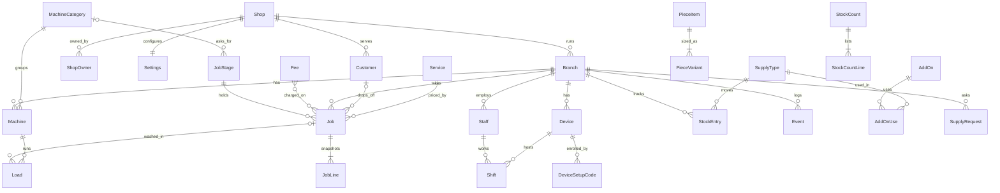

# Ivan & Ivy Laundry — PRD

28 Oct 2026 · JR (updated 3 Nov 2026)

Version 1 runs all three branches from one system: staff record jobs, machine loads and supplies with a few taps, no job is lost when the internet is down, and the owner sees everything from her phone.

## 1. Overview

**Goal.** Replace the logbook with one system across Ivan & Ivy Laundry's three branches. Staff record their normal actions (taking a job, loading and unloading machines, receiving and counting supplies), and the owner sees sales, loads, supplies and every job from her phone.

**Users.** One owner. About 2 staff per branch, using a shared counter tablet and their own phones. Three branches with 5–10 washers and 5–10 dryers each. Mostly drop-off wash-dry-fold; self-service is rare.

**Multi-shop readiness.** Version 1 serves one shop, but the cloud is built as one multi-tenant app so other laundry shops can be added later without a migration: every shop-owned row carries a `shop` foreign key (section 4). Version 1 has exactly one Shop row. Sign-up, billing and plans for other shops are out of scope.

**Reference files.** `prototype/index.html` (look and flow), `docs/brief.md` (vision and decisions), `docs/paper-job-sheet.pdf` (the printed outage sheet, section 6). The prototype is the source of truth for look, layout, copy tone and interaction. This PRD is the source of truth for behaviour, data and rules. Where the two disagree, this PRD wins on behaviour and the prototype wins on look.

**Goals**

1. Taking in a drop-off job is fast enough that staff never skip it.
2. Every machine load is recorded through the load and unload taps staff already make.
3. Supply use is tracked automatically and checked against a count every day.
4. No job is lost because the internet is down: hub-mode branches keep working, and direct-mode branches switch to the paper job sheet and enter it afterwards.

**Success criteria** (measured from event timestamps after a 2-week pilot)

- Median time from the first tap on New job to job created: 30 seconds or less.
- At least 90% of claimed jobs have a washer load and a dryer load linked to them (full-mode branches only).
- A full stock count is saved at every branch on at least 6 of 7 days.
- Hub mode: a simulated 4-hour internet outage loses no events and causes no visible change for staff.
- Direct mode: every job written on the paper job sheet during an outage is entered within one working day of the internet returning, with its sheet time and P number.
- When online, the owner dashboard shows a branch event within 1 minute.

## 2. Scope

**In version 1**

- **Jobs:** drop-off jobs with weighed clothes (per kilo by default, or per load), fixed-price piece items such as comforters (priced by size), or both; minimum kilo for clothes, add-ons and owner-defined fees such as Rush; an optional "Heavy items" per-kilo service for bulky items; optional customer; digital claim stub printable through the device's own print dialog (Android printing, or AirPrint on iPad).
- **Job** board, list and history: owner-configured stages (Received → Washing → Drying → Folding → Ready by default) then Claimed, with a machine picker on stages that ask for one, with payment (cash or GCash) at drop-off or at claim.
- **Machines:** one tap to load and one tap to unload; time in use shown; machines in use longer than a set time are flagged; self-service loads paid at start.
- **Supplies:** owner-managed supply types; automatic deductions per washer load, per packed job and per add-on; receiving stock; stock counts (a full count at closing, or a partial spot check any time) with differences flagged and a count status per branch for the owner; low-stock alerts; staff requests for new supplies, with an owner-unlockable option for staff to add them.
- **People and devices:** devices added as shared or personal with a QR code plus a 6-digit setup code typed into the home-screen app; staff sign in on their phones once per shift; staff PIN on shared devices for chosen actions.
- **Owner:** dashboard across all branches, a watch-only live view of each branch, settings (prices, services, supplies, machines, staff, devices, PIN rules), and a BIR sales export to Excel.
- **Offline:** each branch runs in direct mode (devices use the cloud and need internet; the default for a new branch) or hub mode (a branch hub on local Wi-Fi with a UPS, which keeps working with no internet), with the same app and code in both.
- **Paper job sheet:** a printed A4 sheet for outages, and a "From paper sheet" entry on New job and Claim that keeps the sheet's P number and times (section 6).
- **Tenancy:** a Shop model above Branch, with every shop-owned row scoped to its shop (section 4), so the cloud can later serve more than one shop.
- **Display:** light theme by default, with a dark theme switch saved per device.

**Out of scope for version 1**

- SMS or other customer notifications
- Issuing official receipts (OR)
- Thermal claim stub printing (planned for version 1.1; see section 11)
- Direct Bluetooth printing from a device
- Sign-up, billing, plans and a self-serve onboarding flow for other shops (the data model is ready; see section 4)
- Loyalty, promos and discounts
- Machine maintenance logs
- A customer-facing job tracking page
- Physical job tags (NFC or e-ink); a Phase 2 pilot only if stage tapping proves slow
- A trimmed "floor mode" for staff phones (phones use the standard screens)

## 3. Tech stack and architecture

One Django codebase runs in two roles. Each hub-mode branch has a **hub**, which serves its staff over local Wi-Fi and is the source of truth for that branch's operations. The **cloud** serves the owner, serves the staff of direct-mode branches, and is the source of truth for settings and the catalog.

| Layer | Choice | Source | Notes |
| --- | --- | --- | --- |
| Language and framework | Python 3.13, Django 6 | Default | Same codebase, `APP_ROLE=hub` or `cloud` |
| Staff UI | Django templates + HTMX, served by the hub (or the cloud in direct mode) | Default | No React, no bundler, no client-side database |
| Owner UI | Django templates + HTMX, served by the cloud | Default |  |
| Cloud API | Django REST Framework | Default | Sync endpoints only |
| Hub database | SQLite in WAL mode on SSD | Decision | One branch, a few devices; nightly local snapshot |
| Cloud database | PostgreSQL | Default | SQLite for local development. One shared database for all shops; rows scoped by `shop` |
| Hub hardware | Small x86 mini PC or Raspberry Pi 5 with SSD, router and hub on a UPS | Decision | Intel N100 mini PC; see section 10 |
| Packaging | Docker image, same for hub and cloud | Default | Built for amd64 (N100 hub) and arm64 (Apple Silicon test hub); hubs pull new images automatically overnight |
| Remote access | Tailscale | Default | SSH to any hub from home |
| Owner sign-in | django-allauth, Google; each allowed email is linked to one shop (ShopOwner) | Default | Decided |
| Excel export | openpyxl | Default | BIR sales report |
| Fonts | Saira Condensed, Figtree, JetBrains Mono, self-hosted | Prototype | Hubs must work without internet |

**Django apps**

| App | Owns |
| --- | --- |
| `core` | Shop, ShopOwner, Branch, Machine, MachineCategory, JobStage, settings snapshot, day boundary helpers, current-shop middleware and the tenant-scoped base model |
| `people` | Staff, Device, DeviceSetupCode, Shift, PIN checks |
| `customers` | Customer |
| `catalog` | Service, AddOn, PieceItem, PieceVariant, SupplyType (cloud-owned, synced to hubs) |
| `jobs` | Job, job price lines, status transitions, claim stub, paper sheet entry |
| `machines` | Load, machine state |
| `supplies` | StockEntry ledger, StockCount, SupplyRequest |
| `events` | Event log, hub outbox, cloud inbox, settings pull |
| `owner` | Dashboard, live view, settings screens, BIR export (cloud role only) |

**Staff routes (served by the hub, or by the cloud for direct-mode branches)**

| Route | Method | Purpose |
| --- | --- | --- |
| `/` | GET | Redirect to the device's start screen (New job or Machines); a device without a valid key goes to `/device/setup/` |
| `/device/start/` | GET | Landing page the QR code opens: "Add this page to your Home Screen, then open it from there", with short steps for Android and for iPad and iPhone. Needs no key and sets nothing |
| `/device/setup/` | GET, POST | "Set up this device" with a 6-digit code box; a valid code saves the device key and opens the start screen. Wrong codes: 5 tries, then locked for 1 minute |
| `/shift/` , `/shift/end/` | GET, POST | Who's working (personal devices), end shift |
| `/jobs/new/` | GET, POST | New job form; POST creates the job and returns the claim stub. `?paper=1` opens it with the paper sheet fields (section 6) |
| `/jobs/` | GET | Jobs screen: `?view=board` (default, polls every 20 s), `?view=list` or `?view=history`, with `&date=YYYY-MM-DD` (default today) and `&q=` search |
| `/jobs/<no>/` | GET | Claim stub |
| `/jobs/<no>/advance/` | POST | Move one stage forward; for a stage that asks for a machine, the body carries the machine id or a skip reason |
| `/jobs/<no>/history/` | GET | Job timeline |
| `/jobs/<no>/stage/` | POST | Manual stage override (stage, optional reason) |
| `/jobs/<no>/claim/` | POST | Record payment if unpaid, then mark claimed; optional paper release time (section 6) |
| `/machines/` | GET | Machine grid (polls every 20 s) |
| `/machines/<id>/start/` | POST | Start a load for a job, or self-service with payment |
| `/machines/<id>/unload/` | POST | End the open load |
| `/supplies/` | GET | Stock, recent changes, count form |
| `/supplies/receive/` , `/supplies/count/` | POST | Receive stock; save a stock count (full or partial) |
| `/supplies/request/` , `/supplies/types/new/` | POST | Request a supply; add a type (only when unlocked) |
| `/undo/<event_id>/` | POST | Undo the last action within 6 seconds |

**Owner routes (cloud)**

| Route | Purpose |
| --- | --- |
| `/owner/` | Dashboard, filter by branch |
| `/owner/live/<branch>/` | Watch-only machines and job board |
| `/owner/staff/` | Staff per branch: add, edit, set or reset PIN, deactivate |
| `/owner/machines/` | Machine categories, and machines per branch: add, relabel, recategorise, out of service, remove |
| `/owner/settings/…` | Minimum kilos, PIN rules, job stages, services, fees, add-ons, piece items, supply types, devices, display |
| `/owner/devices/new/` | Add a device: pick branch, kind (shared or personal) and name; shows a QR code and a single-use 6-digit setup code, both valid 15 minutes |
| `/owner/reports/bir.xlsx` | BIR sales export for a date range |
| `/sync/push/` | Hub sends event batches (device-key authenticated) |
| `/sync/pull/` | Hub fetches settings and catalog newer than its version (a new hub calls `/sync/bootstrap/` once for its branch's full state and events) |

**Tenant scoping**

- Every request resolves to exactly one shop: owner requests from the signed-in owner's ShopOwner link; staff and sync requests from the device or hub key, through its branch. A middleware sets the current shop; there is no shop picker and no shop in URLs.
- Shop-owned models inherit a tenant-scoped base model whose default manager filters by the current shop. Code that genuinely needs all shops (migrations, admin reports) uses an explicit unscoped manager.
- A URL that names another shop's branch, job, machine or device returns 404, never 403, so it reveals nothing.
- A hub only ever holds its own shop's settings and catalog and its own branch's operational data.

**Sync protocol**

1. Every write on a hub saves the state change and appends an Event in the same database transaction. Each event has a UUID and a per-branch sequence number.
2. The hub outbox sends unsent events to `/sync/push/` in batches of up to 500, every 30 seconds while online, with exponential backoff on failure.
3. The cloud applies events idempotently (keyed by UUID) to its own copy of each branch's data, and acknowledges the highest sequence number received. The hub marks those events as sent. The cloud accepts events only for the branch (and shop) the hub key belongs to.
4. The hub pulls `/sync/pull/?since=<settings_version>` every 5 minutes and on startup, and applies catalog and settings changes atomically. It receives only its own shop's settings and catalog.
5. Branch operational data flows up only. Settings and catalog flow down only. The single exception is a supply type added by staff on an unlocked hub: it is created with a UUID and pushed up as an event. If two branches add the same name while offline, the cloud keeps both and asks the owner to merge them.
6. Hub status for staff: "Connected" when the device reaches the hub. Cloud status is shown only on the owner's Branch tablets card.

**Deployment modes**

The owner chooses one of two modes for each branch. The codebase, screens and rules are the same in both; only the place that serves the staff screens changes.

| Mode | Staff devices connect to | When the internet is down | Hardware | Use when |
| --- | --- | --- | --- | --- |
| **Direct** (default for a new branch) | The cloud, over HTTPS | Staff screens stop; the branch uses the paper job sheet and enters it once the internet is back (section 6) | Devices and a router with internet | Getting started: the quickest setup, a demo, a new or temporary branch, or very reliable internet |
| **Hub** | The branch hub over local Wi-Fi | The branch keeps working; the owner's view catches up later | Hub, UPS, router, devices | The owner wants service never to depend on the internet |

- `Branch.mode` is `direct` or `hub`; a new branch starts as `direct` with `simple_mode` on, which is also the recommended onboarding setup (direct + simple). The owner can choose otherwise when adding the branch.
- The cloud serves the staff routes only for direct-mode branches and refuses them for hub-mode branches. A hub serves only its own branch.
- In direct mode, each write goes to the cloud database with the same Event appended in the same transaction, so the event history is identical in both modes. No outbox is needed.
- Every direct-mode branch shows a note in Owner → Settings → Branches: "This branch stops working whenever its internet is down. Staff use the paper job sheet until it's back."
- **Direct to hub:**
  1. Prepare the hub with the branch ID.
  2. The hub pulls that branch's current state and events from `/sync/bootstrap/`.
  3. After closing, the owner switches the mode; from then the cloud stops serving that branch's staff screens.
  4. Re-enrol the branch's devices against the hub's address (QR code and setup code, section 6).
- **Hub to direct:**
  1. The hub pushes all unsent events.
  2. When its outbox is empty, the owner switches the mode.
  3. Re-enrol the devices against the cloud's address.
- The owner's Branch tablets card shows "Direct" for direct-mode branches, with the time their devices were last seen.

## 4. Data model

State tables hold the current picture, and the Event log records every change. Both are written in the same transaction on the hub. All primary keys are UUIDs, so records created on different hubs never clash. Money uses `DecimalField(max_digits=10, decimal_places=2)` in Philippine pesos. Weight uses `DecimalField(max_digits=6, decimal_places=1)` in kilograms.

**Tenancy.** A Shop is one laundry business; it owns its branches, settings, catalog, stages, machine categories, fees and customers. Every model below that is not already reached through a Branch carries a `shop` foreign key, and names that must be unique are unique per shop (for example supply type names, staff PINs per branch, machine labels per branch). Version 1 seeds a single Shop for Ivan & Ivy Laundry.

| Model | Key fields | Notes |
| --- | --- | --- |
| Shop | name, code, logo, timezone (Asia/Manila), created_at, archived_at | One per laundry business; version 1 has one |
| ShopOwner | shop, email, user (null until first sign-in) | Owner sign-in allow-list, per shop |
| Branch | shop, name, code, mode (direct, hub; default direct), simple_mode (default on), closing_time, job_seq | `job_seq` issues job numbers |
| Machine | branch, category, label (W1, D1), out_of_service, archived_at |  |
| Staff | name, branch, pin_hash, active | PIN stored hashed |
| Device | branch, kind (shared, personal), name, key_hash, start_screen, last_seen_at, revoked_at |  |
| DeviceSetupCode | device, code_hash, expires_at (15 minutes), used_at | Single use; a device has at most one unused code |
| Shift | staff, device, started_at, ended_at, ended_by (staff, closing) | One open shift per personal device |
| Customer | shop, name, phone | Optional on jobs; shared across the shop's branches, never across shops |
| Service | shop, name, mode (kg, load), price, archived_at | Catalog, cloud-owned; owner can rename, change unit and price, add, and remove (archive) |
| AddOn | shop, name, price, archived_at | Catalog |
| AddOnUse | addon, supply_type, qty | Supplies an add-on uses |
| PieceItem | shop, name, archived_at | Fixed price, not weighed, for example comforters. With PieceVariant (piece_item, label such as Single, Queen or King, price, active): one row per size; an item with one price has a single variant labelled "Each" |
| SupplyType | shop, name, unit, low_level, per_washer_load, per_packed_job, archived_at | Archive only, never delete |
| Job | branch, number, customer (null), service, kg, fees (list of fee ids), notes, status, total, received_at, paid_at, pay_method, pay_ref, claimed_at, created_by, created_at, paper_ref (blank), paper_date (null) | Unique on (branch, number). `received_at` equals `created_at` except for jobs entered from the paper sheet. `paper_ref` holds the sheet's P number (for example "P-7") |
| JobLine | job, label, amount, kind (base, addon, piece, fee) | **Copied** at creation, so later price changes never alter old jobs |
| Load | branch, machine, job (null), self_service, started_at, ended_at, started_by, ended_by, amount, pay_method | At most one open load per machine |
| StockEntry | branch, supply_type, qty (signed), reason (washer_load, packed_job, addon, received, count_adjust), job, load, at | Ledger; on hand = sum of entries |
| StockCount | branch, by, at, partial | With StockCountLine (supply_type, expected, counted, variance), one line per supply counted; never edited or deleted |
| SupplyRequest | branch, name, note, requested_by, status (open, added, dismissed) |  |
| Settings | shop, version, pin_enabled, pin_actions, staff_can_add_supply, min_kg, kg_per_load, check_after_min. Fees are a catalog model, Fee (name, note, amount, archived_at), seeded with Rush (₱50, "Same day"). There is no separate self-service price: self-service uses a per-load service | One row per shop, versioned, cloud-owned |
| Fee | shop, name, note, amount, archived_at | Catalog, owner-editable; seeded with Rush (₱50, "Same day"); chosen per job like add-ons |
| MachineCategory | shop, name, label_prefix, uses_wash_supplies, sort_order, archived_at | Cloud-owned, shared by all of the shop's branches; seeded with Washer (W, uses wash supplies) and Dryer (D) |
| JobStage | shop, name, sort_order, is_first, is_last, ask_for_machine, machine_category (null = any), move_on_when_unloaded, show_in_simple_mode, archived_at | Cloud-owned; seeded Received, Washing (washer), Drying (dryer, move on), Folding, Ready. Job.status points to a stage, or Claimed |
| Event | id (UUID), branch, seq, type, payload (JSON), actor_staff, device, occurred_at, sent_at, received_at | Never deleted. For paper entries, `occurred_at` is the time written on the sheet and the payload carries `from_paper: true` |

## 5. Screens and behaviour

Each screen matches the prototype's look and layout. The prototype keeps state in the browser; the real app does every action on the server and swaps the result in with HTMX.

**Staff screens (hub, or cloud in direct mode)**

| Screen | Prototype | Shows | Actions on the server |
| --- | --- | --- | --- |
| Add to Home Screen | Not in prototype | Branch name and logo; "Add this page to your Home Screen, then open it from there", with 3 short steps for Android (Chrome menu → Add to Home screen) and for iPad and iPhone (Share → Add to Home Screen) | None; it only gets the device to the right address |
| Set up this device | Not in prototype | A 6-digit code box and "Ask the owner for a setup code"; on a device whose key stopped working, "This device isn't set up" above it | Check the code, save the device key, open the start screen |
| Who's working | Not in prototype | Staff names for this branch, PIN pad | Start a Shift on a personal device; wrong PIN shows an error, 5 wrong tries lock for 1 minute |
| New job | Staff → New job | Service chips, kilo keypad (clothes only; 0 for a pieces-only job), piece steppers per size, add-ons, fee chips (for example Rush), tapped on or off like add-ons, customer search, notes, live price summary, payment choice. A "From paper sheet" switch adds P number, sheet date and time received, and paid time | Create Job and JobLines, assign the next number, deduct add-on supplies, write `job_created`, return the claim stub |
| Claim stub | Stub modal | Job number tag, customer, drop-off time, service, weight, price lines, total, payment status; "Paper P-7" under the number for paper jobs | Print opens the device's own print dialog (Android printing or AirPrint) using a print stylesheet sized for a small slip |
| Jobs | Staff → Jobs | One column per active stage (owner-configured, Received to Ready by default); cards with number, customer, kilos, service, age, paid state, overdue flag | Board: advance one stage; Claim (with payment when unpaid); each with Undo for 6 seconds. A Board / List / History switch opens the other two views (section 6, Job list and history); tapping a job in List or History opens its timeline |
| Claim and pay | Claim modal | Amount due, Cash or GCash, optional GCash reference; a "Released on paper" switch adds the time out from the sheet | Set paid_at, pay_method, claimed_at; write `job_claimed` |
| Machines | Staff → Machines | Washer and dryer tiles: idle, in use with time and job number, or flagged when in use past the set time | Start a load (pick a job, or self-service with payment); unload; automatic status changes (section 6) |
| Supplies | Staff → Supplies | On hand, used today, status per supply; recent stock changes, newest first, 10 per page with Newer and Older, each showing the reason, supply, amount, time and the job number it came from (tap to open the job's timeline); count form | Receive stock; save count; request a supply, or add a type when the owner has unlocked it |
| Header | All staff screens | Logo, branch, connection status (hub, or cloud in direct mode), theme switch, signed-in staff name on personal devices, End shift | End shift |

**Owner screens (cloud)**

| Screen | Prototype | Shows | Actions on the server |
| --- | --- | --- | --- |
| Dashboard | Owner → Dashboard | Sales today (cash and GCash), loads today, kilos received, ready but unclaimed; loads per machine; needs-attention list; stock count status per branch; branch tablet status; BIR export | Filter by branch; export the BIR report; turn a supply request into a supply type; open a branch's count history |
| Live branches | Owner → Live branches | One branch at a time: counts, machine grid, job board, offline notice with "as of" time | Read only; refreshes every 20 seconds |
| Settings | Owner → Settings | Minimum kilos (first card, above the PIN rules), Branches (connection mode, and a Simple mode switch per branch; new branches start as Direct + Simple), job stages (name, order, ask for machine, machine type, move on when unloaded, show in simple mode), PIN rules, check-after time, kilos per load, fees (name, note for staff, amount; add or remove; Rush preloaded), services (name, unit, price), add-ons (name, price, and the supplies each one uses), piece items with sizes, supply types, dark theme | Save each field on change; settings version increases and hubs pull it |
| Devices | Not in prototype | Devices per branch with kind, name, last seen, revoke; an unused setup code shows its time left | Add device: shows the QR code and 6-digit setup code (valid 15 minutes, single use) with the steps for staff; new code for an existing device; revoke |
| Staff | Not in prototype | Staff per branch | Owner → Staff tab (between Live branches and Machines), filtered by branch. Add staff (name, branch, 4-digit PIN or Generate); edit name, branch or PIN; reset a forgotten PIN; deactivate (their PIN stops working, past actions stay in history) and reactivate. A PIN must be unique among active staff at the same branch; it is shown once when set and stored hashed |
| Machines | Owner → Machines | Machine categories (name, label prefix, uses wash supplies); machines per branch grouped by category, with a branch filter | Add, rename and remove categories (not while used by a machine or stage); add a machine (label suggested from the prefix), relabel, change category, mark out of service or back, remove an idle machine |

All owner screens show only the signed-in owner's shop. Branch filters, pickers and the dashboard never list another shop's branches.

**Differences from the prototype**

- The sync pill and its offline simulation are replaced by a connection status. Staff never see cloud status in hub mode.
- The PIN prompt appears only on shared devices. Personal devices record the signed-in staff member.
- "Reset sample data" does not exist in the real app.
- Sample prices, recipe amounts, names and the 90-minute check time are examples to replace with real values before the pilot.

## 6. Rules

Anything the prototype does in JavaScript, the server must do exactly as written here.

**Job numbers.** Each branch issues its own sequence, starting at `<branch number> × 1000 + 1` (for example 1001, 2001, 3001) and increasing by 1. Numbers are unique per branch. Owner views show the branch with the number, for example "[Branch 1] #1043". Jobs entered from the paper sheet get the next number when they are entered; the P number is kept separately in `paper_ref`.

**Pricing.** Computed when the job is created and copied into JobLines.

- A job has weighed clothes, piece items, or both. It needs at least one: kg > 0 or one piece.
- Clothes (only when kg > 0):
  - Per-kilo service: billable kg = max(kg, minimum kg); base = billable kg × price per kg.
  - Per-load service: loads = max(1, ceiling(kg ÷ kilos per load)); base = loads × price per load.
  - When kg is 0, there is no service line and no minimum-kilo charge.
- Piece items: a fixed price per piece for the chosen size, not weighed and not counted toward the minimum kilos. Staff weigh the clothes without the pieces.
- Total = clothes base (if any) + sum of (piece quantity × size price) + sum of add-on prices + sum of the fees switched on for the job.
- Each line is rounded to 2 decimals, half up; the total is the sum of the rounded lines.
- Changing a price later never changes an existing job.
- A job entered from the paper sheet is priced by the app with the prices in force when it is entered. If the total differs from the total written on the sheet, New job shows both before saving; staff keep the app's total or add a note explaining the difference.

Philippine shops price bulky items either per piece by size (for example [Mr Jeff](https://mrjeff.ph/pricing): comforter Single ₱500, Queen ₱600, King ₱700) or at a separate, higher per-kilo rate (for example [Suds](https://suds.com.ph/laundry-service-price-list/): comforters ₱125 per kg). Version 1 supports both: piece items for a fixed price, and a "Heavy items" per-kilo service the owner can price or leave unused.

**Job stages**

Stages are owner-configured (Owner → Settings → Job stages). The defaults reproduce the original flow:

| Order | Stage | Ask for machine | Machine type | Move on when unloaded |
| --- | --- | --- | --- | --- |
| First (fixed) | Received | — | — | — |
| 2 | Washing | Yes | Washer only | No |
| 3 | Drying | Yes | Dryer only | Yes |
| 4 | Folding | No | — | — |
| Last (fixed) | Ready | — | — | — |

- The owner can rename any stage, and add, remove (archive) and reorder the middle stages. The first and last stage can't be removed or moved, because job creation, packing deductions and Claim depend on them. A stage with jobs in it can't be removed until they move.
- **Ask for machine:** moving a job into the stage with its board button opens a picker of that branch's machines, limited to the chosen category or all categories. Busy and out-of-service machines are shown but disabled. Picking one is exactly the same as starting that machine for the job on the Machines screen: it creates the Load, deducts wash supplies if the category uses them, and records the stage change "in W3".
- **Skip:** staff may move without a machine only by entering a reason (required). The timeline shows "no machine recorded · reason".
- **Leaving a stage** ends the job's open load automatically, so the machine frees up without a second tap.
- **Move on when unloaded:** when the job's last load in that stage is unloaded on the Machines screen, the job moves to the next stage automatically, unless that next stage also asks for a machine.
- **Starting a machine from the Machines screen** moves a job into the stage linked to that machine's category if the job is at an earlier stage.
- One job per machine at a time.

**Simple mode** (per branch, for branches new to the system; on by default for a new branch)

- The owner switches each branch between full and simple mode (Owner → Settings → Branches). The stage list and its settings are shared by all branches; simple mode only changes what a branch's staff see.
- Each middle stage has a shared **Show in simple mode** tick (default off). The first and last stage are always shown. With the defaults, a simple-mode board is Received → Ready, then Claim.
- At a simple-mode branch: the board shows only those stages; the card button moves to the next shown stage, skipping hidden ones; the machine picker never opens (no skip reason needed); the Machines screen is hidden; the override lists only the shown stages. New job, Jobs list and history, Claim, Supplies and all PIN rules are unchanged.
- A job sitting in a hidden stage (for example after switching to simple mode) appears in the nearest earlier shown column with an "in Drying" label, and its button moves it to the next shown stage.
- Switching back to full mode keeps every job where it is; they continue through all stages.
- Because no machines are used, washer-load supply deductions don't happen at a simple-mode branch; packing and add-on deductions do, and the stock count corrects the rest.
- Owner views: Live branches hides that branch's machines and machine counts and shows a "Simple mode" badge; the dashboard's loads-per-machine chart leaves simple-mode branches out; the Branch tablets card shows a "Simple" badge.

* Every card on the board has its own next-stage button (or Claim when Ready), so any number of jobs in a column can move independently. The button moves one stage forward. Undo reverses it for 6 seconds, from the device that made it, by writing a compensating event; it never deletes one.
* **Manual override:** each card also has an edit button that sets the job to any stage from Received to Ready, forward or back, with an optional reason. It asks for a PIN on shared devices when the owner's "Changing a job's stage by hand" PIN rule is on (default on). It writes a `stage_overridden` event (from, to, reason, staff) that shows in the job timeline as "Stage changed to X, manual override from Y". Packed-job supplies are deducted only the first time a job reaches Ready, and moving back never returns stock. Release always goes through Claim so payment is recorded. The override is a correction, so it never opens the machine picker and leaves any open load running (staff unload it on the Machines screen).
* Every action form carries the job's current stage. If the stage has changed since the page loaded (another device moved it), the action is refused with "Job #1043 is already in Drying" and the page refreshes.

**Paper job sheet** (outages and hub failure)

Staff switch to paper whenever the app can't be reached: the internet is down at a direct-mode branch, or a hub has failed. The sheet is `docs/paper-job-sheet.pdf`: one A4 page printed landscape at 100% and cut into two identical A5 half-sheets. It covers what simple mode uses, so it has no machines, self-service or stock sections. Each branch keeps a stack of printed sheets at the counter.

- **Header:** branch, date, staff, "Sheet ___ of ___", the reason (internet down, hub down, other), and from and to times.
- **Part A · New jobs:** one row per job, in the same order as the New job screen: P number, time, service, kg, pieces by size and quantity, add-ons and fees, customer (optional), total, paid (C = cash, G = GCash with reference, U = unpaid), a Ready tick, and the app job number written in once entered.
- **Part B · Released to customer:** job number or P number, time out, amount, cash or GCash, staff, and a tick once claimed in the app.
- **Footer:** cash and GCash totals, who entered the sheet into the app, and the entry steps below.
- **P numbers:** staff write P-1, P-2… in order for the day and keep counting on the next sheet (P-12, P-13…). The P number is written on whatever slip the customer gets, since the app's claim stub can't be printed.

**Entering the sheet once the app is back**

1. For each Part A row, open New job with "From paper sheet" on and enter the row: P number, the sheet's date and time received, the job details, payment and the time paid if paid at drop-off. Write the new job number in the row's last column.
2. Move rows ticked Ready to Ready (packed-job supplies are deducted then).
3. For each Part B row, find the job (by job number or P number), tap Claim with "Released on paper" on, enter the time out and the payment as written, and tick the row.
4. Write your name in the footer and file the sheet.

Rules for paper entries:

- `received_at` and the `job_created` event's `occurred_at` are the sheet's date and time, not the entry time; `created_at` keeps the real entry time. `paid_at` and `claimed_at` use the times from the sheet. The sheet date can be today or up to 7 days back, never in the future.
- Dashboard totals, Jobs List and History, the BIR export and "Kilos received" all use `received_at`, `paid_at` and `claimed_at`, so paper jobs count on the day they really happened.
- A P number is unique per branch and sheet date; entering the same one twice warns "P-7 on 3 Nov is already job #1052" and opens that job instead.
- Search finds jobs by P number. The claim stub and the job timeline show "Received on paper as P-7, entered by [Staff] at [time]".
- Paper entries skip the machine picker and add no loads, at any branch; washer-load supplies for them are corrected by the next stock count.
- On a shared device, paper entry asks for a PIN when the owner's PIN rule for creating a job or for claim and payment is on.

**Job list and history** (staff Jobs screen, List and History views)

- The date filter defaults to today (Asia/Manila), with Today, Yesterday and a date picker. Search looks at all dates and matches job number, P number, customer name or phone, notes, status and payment method.
- **List** shows every job of the branch that was received, paid or released on the chosen day, including released jobs, newest first. Each row shows the number, customer, size (kg and pieces), service, status, received and released times, and payment: amount, method (Cash or GCash) and time paid, or "Unpaid" with the amount due. Paper jobs show a "Paper" badge.
- **Job timeline** (opened from List or History) is built from that job's events in order: Received (size, service, total, staff); each washer and dryer load and unload (with time in use); each stage change (manual, or automatic with the machine that caused it); Paid (amount, method, GCash reference, staff, "at drop-off" when paid on intake); Released to customer (staff). It also shows the price lines and a link to the claim stub.
- **History** lists every event of the branch on the chosen day, newest first, including self-service payments, with a day summary: jobs received, jobs released, and money collected in total, Cash and GCash.
- Both views read the Event log; they never show events from other branches.

**Machines**

- Machines belong to a branch and a **category**. Categories are shared by all of the shop's branches: Washer (prefix W, uses wash supplies) and Dryer (prefix D) by default; the owner can add more (for example Steam press, prefix P) and choose whether each uses wash supplies per load. A category used by a machine or a stage can't be removed.
- The owner adds, relabels and recategorises machines per branch (Owner → Machines), marks them out of service (shown greyed on the staff grid, not selectable) and removes idle ones (archived, history kept). Labels are unique per branch.
- The staff Machines screen groups machines by category, in category order.

* A machine is idle or in use. In use means it has a Load with no `ended_at`. There is no countdown and no estimated finish time.
* Starting a load requires the machine to be idle. Eligible jobs: Received or Washing for washers; Washing or Drying for dryers.
* Starting a washer load deducts every supply type's per-washer-load amount.
* Unloading sets `ended_at` and shows "Unloaded after N min".
* A machine in use for at least `check_after_min` (default 90) is flagged "check it" on staff and owner screens.
* Self-service: staff pick one of the active per-load services (the owner adds one, for example "Self-service"; none is preloaded) and the customer pays its price at start (cash or GCash). It counts in sales. With no per-load service, the self-service option is hidden.
* "Loads today" counts loads started since midnight, Asia/Manila time.

**Supplies**

- On hand = sum of StockEntry quantities for the branch and supply type.
- Deductions: washer load start (per-washer-load amounts), job reaching Ready (per-packed-job amounts), job creation (add-on supply use). Archived supply types are skipped.
- Receive adds a positive entry.
- Stock count: staff can save one at any time; nothing is tied to closing time. A full count covers every active supply type. A partial count (spot check) covers only the supplies typed in and leaves the rest untouched. Each counted line stores expected, counted and variance (counted − expected). Each non-zero variance writes a `count_adjust` entry so on hand equals the count. A variance of 1–3 shows as a warning; more than 3 as critical.
- Count status (owner dashboard, one line per branch) uses the latest full count, by calendar day in Asia/Manila time. It is green if that count was today or yesterday, orange if 2 days ago (one closing missed), and red if 3 or more days ago or never. Partial counts don't change the colour. Tapping the line opens that branch's count history: each count's time, staff member, full or partial, and expected → counted for each supply.
- Low stock: on hand ≤ low level.
- Supply types are added by the owner. Staff can add them only when `staff_can_add_supply` is on; otherwise they send a SupplyRequest. Names are unique within a shop, ignoring case; an archived match must be restored, not re-added.

**Owner alerts** (needs-attention list)

- Low stock at any branch.
- A count saved today or yesterday at a branch has a non-zero variance (if none was saved then, the latest count), one alert per supply.
- A job has been Ready for more than 2 days (noting if unpaid).
- A branch hub has not synced for more than 30 minutes.
- A direct-mode branch's devices have not been seen for more than 30 minutes during opening hours ("may be on paper").
- An open supply request.

**Totals on the dashboard** (day boundary: midnight, Asia/Manila)

- Sales today = jobs with `paid_at` today + self-service loads started today, split by cash and GCash.
- Kilos received today = sum of kg for jobs with `received_at` today.
- Ready, not claimed = jobs in Ready, with the unpaid amount still to collect.

**People and devices**

- **Enrolment.** Installed home-screen apps keep their own storage on iPad and iPhone, so a key saved in the browser before "Add to Home Screen" is lost. The key is therefore saved only inside the home-screen app, and the same flow is used on every device:
  1. The owner taps Add device (Owner → Settings → Devices) and picks the branch, kind (shared or personal) and a name. The screen shows a QR code and a 6-digit setup code, both valid for 15 minutes; the code works once.
  2. Staff scan the QR code (or type the branch's address). It opens the Add to Home Screen page for that address: the hub, or the cloud for a direct-mode branch. Nothing is saved yet.
  3. Staff add the page to the home screen and open the new icon. It opens on "Set up this device".
  4. Staff type the 6-digit code. The server checks it against unused, unexpired codes for that address's branch, marks it used, and saves a long-lived device key cookie inside the home-screen app. The device opens on its start screen (New job for shared, Who's working for personal) from then on.
- Requests without a valid, unrevoked key go to "Set up this device" and can't open any other page. Wrong codes lock the code box for 1 minute after 5 tries.
- **Lost key** (site data cleared, app removed, browser reinstalled, or a new device): the device shows "This device isn't set up". The owner taps New code on that device in Devices (or adds a new device and revokes the old one), and staff type the code. No re-scan is needed if the home-screen icon is still there.
- **Switching a branch's mode** changes its address, so each device is re-enrolled with a new QR code and setup code (about a minute per device).
- **Forgotten PIN:** the owner resets it in Owner → Staff; the new PIN is shown once.
- Personal devices require an open Shift. The shift ends at End shift or at the branch's closing time. All actions record the shift's staff member.
- Shared devices have no shift. When the PIN is on, the actions chosen by the owner (default: claim and payment, and changing a job's stage by hand; creating a job, stock counts, receiving stock and adding a supply type are off until the owner ticks them) ask for a PIN, and the matching staff member is recorded. When the PIN is off, the device is recorded as the actor.
- Owner sign-in: Google sign-in succeeds only for an email listed as a ShopOwner, and the session is bound to that shop.

## 7. Design system

Copy the tokens from the `:root` block of `prototype/index.html` into `static/css/tokens.css`. The theme is light by default; dark applies when `data-app-theme="dark"` is set on `<html>`, chosen per device and saved in a cookie.

| Token | Light | Dark | Use |
| --- | --- | --- | --- |
| `--bg` | `#E8F5F5` | `#0A1230` | Page background |
| `--surface` | `#FFFFFF` | `#111B44` | Cards, header, rail |
| `--ink` | `#16246A` | `#E6ECFF` | Text, selected segments |
| `--muted` | `#566284` | `#9DA9CF` | Secondary text |
| `--line` | `#CBDFE3` | `#263370` | Borders |
| `--accent` | `#2537A0` | `#7D91FF` | Royal blue: primary buttons, headings, machines in use |
| `--teal` / `--tag` | `#19B5AF` | `#24BDB6` | Claim tags, badges |
| `--sky` | `#4AA8E0` | `#5BB6EC` | Dryer bars on the dashboard |
| `--good` `--warn` `--crit` | `#1D7F5C` `#A06400` `#B83A28` | `#53C08E` `#E3A93C` `#F07C68` | Status only, never decoration |

**Type.** Saira Condensed 800, uppercase, for headings and the brand name; Figtree 400–700 for body; JetBrains Mono for job numbers, kilos and money (tabular figures). Self-host all three, because hubs run without internet.

**Signature details to keep**

- The job number tag: a teal tag with a punched hole, used everywhere a job number appears.
- Porthole machine tiles: a ring around a drum; a solid royal blue ring when in use, amber when flagged, plain when idle.
- The claim stub: a perforated edge with notches.
- The hexagon badge logo in the header. The prototype shows a generic placeholder ("Bula & Banlaw Laundry") drawn as SVG; the real app uses the shop's own logo and name (from its Shop row) in the same badge style and colours.

**Layout rules**

- Tablet and desktop: a left rail with New job, Jobs, Machines, Supplies. Below 760 px wide: a bottom bar with the same four items.
- Touch targets at least 44 px; primary controls 56 px.
- Only the job board scrolls sideways, inside its own container. The page never scrolls sideways.
- Every action shows a toast; reversible actions include Undo.

**Templates**

- `base.html` (header, rail or bottom bar, toast area, theme attribute)
- `jobs/new.html`, `jobs/_paper_fields.html`, `jobs/board.html`, `jobs/_card.html`, `jobs/_stub.html`, `jobs/_claim.html`
- `machines/grid.html`, `machines/_tile.html`, `machines/_start.html`
- `supplies/index.html`, `supplies/_count.html`, `supplies/_type_form.html`
- `people/device_start.html`, `people/device_setup.html`, `people/shift.html`, `people/_pin_pad.html`
- `owner/dashboard.html`, `owner/live.html`, `owner/settings/*.html`, `owner/devices/_add.html`

The owner's live view reuses `jobs/_card.html` and `machines/_tile.html` with `read_only=True`.

## 8. Non-functional requirements

| Area | Requirement |
| --- | --- |
| Speed | Hub pages respond in under 200 ms on local Wi-Fi; actions complete in under 300 ms. Direct-mode pages respond in under 1 second on shop internet. Owner dashboard loads in under 2 seconds on mobile data. |
| Devices | Android tablets (10" or larger) and Android phones, current Chrome, in both modes. iPad and iPhone with current Safari are also supported in direct mode (claim stubs print through AirPrint or stay digital). Installed to the home screen and enrolled from inside the home-screen app (section 6). Works at 360 px width and up. |
| Offline | Hub mode: loss of internet has no visible effect on staff; router and hub run at least 2 hours on the UPS; a fully offline branch keeps at least 30 days of unsent events. Direct mode: staff use the paper job sheet, and paper entries keep their real times (section 6). |
| Hub failure | The paper job sheet is used until a spare hub is swapped in. A new hub restores its branch from the cloud (all synced events) in under 30 minutes. |
| Data safety | Events are never deleted or edited. Hub: SQLite WAL with a nightly local snapshot (keep 7). Cloud: daily Postgres backups (keep 30). |
| Tenant isolation | No query, page, export, sync response or backup restore exposes one shop's data to another. Shop-owned models use the tenant-scoped manager by default; another shop's records return 404. A per-shop data export (CSV or JSON) can be produced from the cloud for offboarding or privacy requests. |
| Security | Device keys, setup codes and PINs stored hashed. Setup codes are single use and expire after 15 minutes. PIN pad and setup code box lock for 1 minute after 5 wrong tries. Cloud on HTTPS only. Sync endpoints accept only enrolled hub keys, and only for that hub's branch. Owner access via the per-shop ShopOwner allow-list. Hubs reachable remotely only through Tailscale. |
| Accessibility | Real buttons and labelled inputs, visible focus, 44 px minimum targets, status shown by text as well as colour. |
| Locale | Philippine pesos (₱), kilograms, Asia/Manila time, English interface. |
| Updates | Hubs pull the new Docker image nightly after closing time. A schema migration must be backward-compatible with events from the previous version. |
| Testing | pytest for pricing, stage transitions, stale-action refusal, stock ledger, sync idempotency (replayed and out-of-order batches), tenant isolation (a test fails if a shop-owned model lacks scoping; cross-shop requests return 404), device setup codes (expiry, single use, lockout, wrong branch) and paper entries (backdated times in totals, duplicate P numbers). An outage test: a hub runs 4 hours offline under load, then syncs with no loss. Cypress end-to-end for New job → load → unload → Ready → Claim, for the count, and for entering a paper sheet. |

## 9. Delivery

**Milestones, in build order**

1. **Counter core:** Shop and the tenant-scoped base model, catalog, pricing, New job (including paper entry), claim stub, job board, claim and pay, on a single dev server on the laptop.
2. **Machines and supplies:** loads, automatic stage changes, stock ledger, deductions, receive, count, supply types and requests.
3. **People and devices:** QR and setup code enrolment, shifts on personal devices, PIN on shared devices, Undo.
4. **Owner (cloud):** dashboard, live view, settings, devices, staff, BIR export, per-shop owner sign-in.
5. **Hub and cloud split:** `APP_ROLE`, event outbox, push and pull sync, Docker images built for amd64 and arm64, automatic updates, Tailscale. Tested with the laptop as the hub, including the 4-hour outage test.
6. **Pilot and rollout:** follow the rollout plan below.

**Rollout plan.** Branches start in direct + simple mode (the onboarding default) as soon as milestone 4 is on the VPS, so the system is in real use before any hub is bought. Hub hardware is bought in stages, so only about ₱16,300 is spent before a hub has run on real hardware, and the rest only after the pilot succeeds.

| Step | Hub used | What happens | Done when | Spend |
| --- | --- | --- | --- | --- |
| 1. Build milestones 1–4 | Laptop (dev server) | The agent builds one milestone at a time; JR reviews each against the prototype and the acceptance checklist | Each milestone's checklist items pass | ₱0 |
| 2. Direct + simple pilot | None; the cloud on the VPS | Load the owner's real prices and supplies; enrol the pilot branch's counter tablet and phones; train staff with the onboarding kit; print paper job sheets | 2 weeks; success criteria (section 1) met for direct mode | Devices for one branch, about ₱21,300; VPS about ₱700 a month |
| 3. Milestone 5 on the laptop hub | Laptop running `APP_ROLE=hub`; cloud on the VPS | Hub and cloud split, sync, outage test. For the outage test, cut the internet at the router (unplug the modem), not the laptop's Wi-Fi | 4-hour outage test passes with no lost events | ₱0 |
| 4. Home dry run | Laptop as hub on the home router | Enrol JR's phone as a personal device and another device as shared; run a full day of sample jobs, including an internet cut | Phone and second device stay in step through the cut | ₱0 |
| 5. Real-hardware check | N100 hub, UPS and router at home for 1 week | Install Ubuntu, Docker and Tailscale; run the dry run again | Runs 7 days unattended; restarts by itself after a power cut; the UPS holds; the overnight update applies | About ₱16,300 |
| 6. Pilot branch to hub mode, then full mode | The same hub, moved to the branch | Follow Direct to hub (section 3) after closing; turn simple mode off when staff are ready for machines and stages | 2 weeks in hub mode; hub success criteria met | Router if needed (section 10) |
| 7. Branches 2 and 3, and the spare hub | Direct first, hubs prepared at home later | Same path as the pilot branch | Both branches running; the spare hub tested once | The remaining hardware (section 10) |

**Using the laptop as a test hub**

- Turn off sleep while on power; a sleeping hub looks like a dead hub to the phones.
- Allow incoming connections in the laptop's firewall. Devices reach it by its local address or `<laptop-name>.local`.
- If the laptop is an Apple Silicon Mac, it runs the arm64 image while the N100 runs amd64; both builds must pass the tests.
- A laptop cannot prove 24/7 running, recovery from a power cut, the UPS, overnight updates or the Ubuntu and Tailscale setup. Step 5 checks those on the real hub before a branch moves to hub mode.

**Acceptance checklist**

- [ ] A job can be created with weight, service, add-ons, pieces, fees and an optional customer, and its total matches the pricing rules; a pieces-only job (0 kg) has no service line and no minimum-kilo charge
- [ ] The owner can add a piece item, add or remove sizes, change a size's price and archive an item, and staff see the change on the New job screen
- [ ] Jobs List shows released jobs with amount, method and time paid; the date filter and search work; a job opens its full timeline from receiving to release
- [ ] Jobs History shows the day's events and its received, released and collected totals match the jobs and self-service loads
- [ ] The owner can rename a service, change its unit (per kg or per load) and price, add and remove services and add-ons, set or remove the supplies an add-on uses (and stock is deducted accordingly), and add, edit or remove fees; staff see the changes on New job, and old jobs keep their prices
- [ ] Every card on the board can be moved on its own, and the edit button sets any stage with a reason that appears in the job timeline
- [ ] Moving a job into a stage that asks for a machine opens the picker limited to that stage's category; picking a machine starts its load (and wash-supply deduction), ends the previous load, and shows "in W3" in the timeline
- [ ] Skipping the machine requires a reason, and the timeline shows "no machine recorded" with it
- [ ] Unloading a machine in a "move on" stage moves the job to the next stage
- [ ] The owner can rename, add, remove and reorder middle stages and set Ask for machine and Machine type; the board updates for staff
- [ ] The owner can add a machine category and machines per branch, mark a machine out of service (staff can't pick it) and remove an idle one
- [ ] A new branch starts in direct mode with simple mode on
- [ ] A branch in simple mode shows only the stages ticked for simple mode (Received and Ready by default), hides the Machines screen, never opens the machine picker, and labels jobs sitting in hidden stages; switching back to full mode keeps every job
- [ ] Live branches and the dashboard leave out machines for simple-mode branches and mark them "Simple"
- [ ] Changing a price does not change existing jobs
- [ ] Starting a washer load moves a Received job to Washing and deducts washer-load supplies
- [ ] Starting a dryer load moves the job to Drying; unloading it moves the job to Folding
- [ ] Moving a job to Ready deducts packed-job supplies
- [ ] Claim records payment (cash or GCash) when unpaid, then marks the job claimed
- [ ] An action on a job that another device has already moved is refused with a clear message
- [ ] Undo reverses the last action within 6 seconds and writes a compensating event
- [ ] A machine in use past the check time is flagged on staff and owner screens
- [ ] A stock count writes adjustments and shows the variance to the owner; a partial count changes only the supplies counted
- [ ] The owner's count status turns orange after one missed full count and red after two, and opens the count history
- [ ] Staff cannot add a supply type unless the owner unlocks it; a request reaches the owner's dashboard
- [ ] An archived supply disappears from staff screens and deductions but stays in past counts and reports
- [ ] A device without a valid key cannot open any page; a revoked device is refused immediately
- [ ] On an iPad, an iPhone and an Android phone: scan the QR, add to home screen, open the icon, type the code, and the device stays enrolled after closing and reopening the app
- [ ] A setup code fails after 15 minutes, after one use, and at another branch's address; 5 wrong codes lock the box for 1 minute
- [ ] A device whose key was cleared shows "This device isn't set up" and re-enrols with a new code
- [ ] The owner can reset a staff PIN, and the old PIN stops working
- [ ] A personal device records the signed-in staff member; the shift ends at closing time
- [ ] A paper sheet entered the next day puts its jobs, payments and claims on the sheet's day in the dashboard, Jobs History and BIR export; the P number is searchable and shown on the stub and timeline; entering the same P number twice is caught
- [ ] With the internet cut for 4 hours, every device in a hub-mode branch keeps working and stays in step, and no events are lost after reconnecting
- [ ] The owner dashboard totals match the jobs and self-service loads for the day
- [ ] The BIR export opens in Excel with daily sales by branch and payment method
- [ ] Screens match the prototype at 390 px and 1280 px, in light and dark themes
- [ ] With a second test shop seeded, its owner, devices and hub see none of the first shop's data, and requests for the other shop's records return 404
- [ ] In direct mode, an iPad in Safari can complete New job → Claim, and the claim stub prints through AirPrint or shows as a digital stub

* [ ] The Docker image builds and passes the tests on both amd64 and arm64
* [ ] On the real hub: it runs 7 days unattended, restarts by itself after a power cut and resumes sync, and the overnight update applies

- [ ] Every staff flow passes the same tests in hub mode and in direct mode
- [ ] A branch can be switched from direct to hub mode and back with no lost or duplicated events

**Decisions**

| Topic | Decision |
| --- | --- |
| Naming | "Job" everywhere; "claim stub" for the customer's slip |
| Architecture | H1: a Django + HTMX hub per branch on local Wi-Fi with a UPS; the cloud serves the owner and holds settings; any branch can instead run in direct mode (devices use the cloud) with the same app |
| Default setup | A new branch starts in direct + simple mode, the onboarding recommendation; it moves to hub mode and full mode when the owner is ready |
| Tenancy | One multi-tenant cloud app with a shared Postgres database; a Shop model above Branch; every shop-owned row scoped by `shop`; version 1 has one shop |
| Data | State tables plus an append-only event log written in the same transaction; UUID keys |
| Sync | Branch data flows up only; settings and catalog flow down only |
| Devices | Counter tablet (shared) and staff phones (personal) per branch; Android in both modes, iPad and iPhone Safari in direct mode |
| Device enrolment | QR code opens the Add to Home Screen page; a single-use 6-digit setup code typed into the home-screen app saves the key; the same flow on every device |
| Sign-in | Personal: name and PIN once per shift, automatic sign-out at closing. Shared: PIN on claims and payments, switchable by the owner |
| Outages | Direct mode and hub failure fall back to the A4 paper job sheet with P numbers; paper entries keep the sheet's times |
| Pricing | Per kilo by default, per load available; piece items at a fixed price per size, with no weight needed; services, add-ons and piece items are all owner-editable (name, unit, price), removing one archives it; fees are an owner-edited list (Rush preloaded) chosen per job like add-ons; self-service uses a per-load service, with no separate price; lines copied at creation |
| Stages | Owner-configured stages (first and last fixed); each can ask for a machine of a category; picking a machine and starting it on the Machines screen are the same action; skipping needs a reason; leaving a stage ends its load; board button moves one stage forward; pencil override sets any stage; Undo for 6 seconds |
| Machines | Owner-managed per branch, in owner-defined categories (Washer and Dryer by default); one job per machine at a time; out of service hides a machine from pickers |
| Simple mode | Per-branch switch for onboarding, on for new branches; one shared stage list with a "show in simple mode" tick per stage; hides machines and the picker; PINs always apply |
| Machines | Time in use only; flag after a set time (default 90 min) |
| Supplies | Ledger; owner-managed types; archive, never delete; staff add only when unlocked |
| Job numbers | Per branch, starting at branch number × 1000 + 1; paper jobs keep their P number alongside |
| Day boundary | Midnight, Asia/Manila |
| Owner live view | Watch only |
| Theme | Light by default, dark per device |
| Claim stub printing | Version 1: digital stub plus the device's print dialog. Version 1.1: hub-driven LAN thermal printing (section 11) |
| Out of scope | SMS, official receipts, thermal printing (v1.1), sign-up and billing for other shops, loyalty, maintenance logs, customer tracking page, physical job tags |

**Resolved questions** (agreed on 28 Oct 2026; tenancy and devices updated 2 Nov 2026; enrolment, default mode and paper sheet 3 Nov 2026)

| Question | Decision |
| --- | --- |
| Owner sign-in method | Google sign-in through django-allauth, allowed only for emails listed as a ShopOwner of a shop |
| Cloud hosting | A small VPS in Singapore (for example DigitalOcean, 1 vCPU and 2 GB) running the same Docker image; one instance serves every shop |
| Hub hardware | An Intel N100 mini PC with a built-in SSD at each branch, plus one spare (section 10) |
| Undo window | 6 seconds; revisit after the pilot |
| Separate app per shop or one shared app | One shared app and database, scoped by shop |
| Enrolling iPad and iPhone home-screen apps | QR code plus a 6-digit setup code typed inside the home-screen app, for all devices |
| Default mode for a new branch | Direct + simple |
| Recording jobs during an outage | A4 paper job sheet with P numbers, entered afterwards with the sheet's times |

**Still to collect from the owner before the pilot** (they don't block the build)

- Real prices, services, add-ons, supply types and amounts per load
- Branch names and closing times
- A sample of her current BIR Excel sheet, so the export matches it

## 10. Hardware and setup

Each branch needs at most about ₱37,600 of hardware. All three branches plus a spare hub cost at most about ₱124,000 once, and the cloud costs about ₱760 a month. The hub part alone (mini PC, UPS and router) is about ₱16,300 per branch. A branch whose existing router is good enough saves ₱3,000. A branch with no internet uses a ₱1,990 SIM router instead.

Branches start in direct mode, which needs no hub or UPS: only the tablet, phones, pouches and cables, about ₱21,300, plus a router if its current one isn't good enough, and a stack of printed paper job sheets. Buy hub kits in the stages set out in the rollout plan (section 9): one hub kit first, the rest after the pilot. Development and the first hub tests use JR's laptop as the hub.

**Shopping list per branch**

| Item | Qty | Unit price | Subtotal | Notes |
| --- | --- | --- | --- | --- |
| Intel N100 mini PC, 16 GB RAM, 500 GB SSD (for example Beelink Mini S12 Pro) | 1 | ₱11,000 (estimate) | ₱11,000 | The branch hub (hub mode only). Wired to the router. |
| UPS, 650 VA (for example APC Easy UPS BVX650I-PH) | 1 | ₱2,299 | ₱2,299 | Hub mode. Keeps the hub and router running through brownouts. A Secure 650VA at ₱1,595 is a cheaper option. |
| Router (budgeted as a dedicated AC1200, for example TP-Link Archer C6; see Network options) | 1 | ₱3,000 | ₱3,000 | Optional if the existing router is good enough. Swap for a SIM router where there is no internet. |
| Android tablet, about 11" (for example Samsung Galaxy Tab A9+) | 1 | ₱13,000 (estimate) | ₱13,000 | Counter tablet. The 8.7" Tab A9 at ₱8,990 also works, but the keypad is tight. |
| Android phone (for example Redmi A5, 3 GB / 64 GB) | 2 | ₱3,599 | ₱7,198 | One per staff member on shift. |
| Waterproof phone pouch with armband or lanyard | 2 | ₱300 (estimate) | ₱600 | Touch-through plastic. |
| Ethernet cable, power strip, tablet stand | 1 set | ₱500 (estimate) | ₱500 |  |
| **Per branch** |  |  | **₱37,597** |  |

A LAN thermal printer (about ₱2,000–4,000) joins this list in version 1.1 (section 11); it is not bought for the version 1 pilot.

**Network options per branch.** The hub and devices only need to share one local network; any common Wi-Fi router works.

| Branch situation | Use | Cost | Notes |
| --- | --- | --- | --- |
| Has internet, and the provider's router is reliable | The existing router | ₱0 | Check the router settings below |
| Has internet, but the provider's router is weak or restarts often | A dedicated router (for example TP-Link Archer C6) with the provider's modem plugged into it | ₱3,000 | The budgeted default |
| No internet line | A plug-in 4G LTE router with a SIM slot and LAN ports (for example TP-Link TL-MR100) | ₱1,990 plus prepaid load | Hub mode only. A few MB of data a month is enough, so the cheapest load works. Telco prepaid home Wi-Fi units also work if they have a LAN port and allow 10 or more devices. Avoid battery pocket Wi-Fi. |

**Router settings, on whichever router is used**

- Client or AP isolation is off, so devices can reach the hub.
- The tablet and phones join the main network, not a guest network (guest networks usually block device-to-device traffic).
- The hub has a reserved address (DHCP reservation).
- The router is plugged into the UPS.

**Connecting the hub.** Use an Ethernet cable whenever the hub can sit next to the router (both are on the UPS anyway). The N100 mini PC also has built-in Wi-Fi, which is acceptable when the layout forces it. In that case, save the shop network on the hub so it reconnects by itself after a router restart, and keep the hub away from the metal washers and dryers.

**Once for the business, and running costs**

| Item | Cost | Notes |
| --- | --- | --- |
| 3 branches × ₱37,597 | ₱112,791 |  |
| Spare hub (N100 mini PC), pre-installed | ₱11,000 (estimate) | Couriered to any branch if a hub fails |
| **One-time total** | **about ₱123,800** |  |
| Cloud VPS, Singapore, 1 vCPU and 2 GB | US$12 a month, about ₱700 | Owner dashboard, direct-mode branches, sync and backups |
| Domain name | about ₱700 a year | For the owner's dashboard address |
| Tailscale and Google sign-in | Free at this size |  |

Prices are retail listings checked on 28 Oct 2026. Items marked as estimates had no reliable Philippine listing, so expect them to vary. Staff can use phones they already own instead of the Redmi phones, as long as the phones run a current Chrome (or Safari on iPhone in direct mode).

**How the setup works**

1. **Cloud, once.** Rent the VPS, point the domain at it, and run the Docker image with `APP_ROLE=cloud`, Postgres and daily backups. Create the Shop and add the owner's Google email as its ShopOwner. Enter branches (they start as Direct + Simple), machines, staff, services, prices and supply types in Owner → Settings.
2. **Each hub, prepared at home** (hub mode only). Install Ubuntu Server on the mini PC, join it to Tailscale, and run the Docker image with `APP_ROLE=hub` and that branch's ID. The hub pulls the catalog and settings from the cloud; after that it can run with no internet.
3. **At the branch.** Set up the network for that branch's situation (Network options above): the existing router, a dedicated router with the provider's modem plugged into it, or a SIM router. For hub mode, connect the hub by cable, or by Wi-Fi if the layout forces it, plug the router and hub into the UPS, and apply the router settings: isolation off, no guest network, a reserved address for the hub, and a local name (for example `ivy.local`).
4. **Devices.** In Owner → Settings → Devices, add the counter tablet (shared) and each staff phone (personal). For each one: scan the QR code with the device on the shop Wi-Fi, add the page to the home screen, open the new icon, and type the 6-digit setup code. Put the phones in their pouches.
5. **Paper sheets.** Print a stack of paper job sheets (`docs/paper-job-sheet.pdf`) and keep them at the counter.
6. **Daily use.** In direct mode, devices talk to the cloud over the internet. In hub mode, devices talk only to the hub over local Wi-Fi; the hub sends events to the cloud whenever the internet is up and pulls price and settings changes every 5 minutes.
7. **Updates and backups.** Hubs install new versions automatically each night after closing. Each hub keeps 7 nightly snapshots; the cloud keeps 30 daily backups and every synced event.
8. **If something breaks.** Internet down: hub-mode branches carry on and the owner's view catches up later; direct-mode branches switch to the paper job sheet and enter it once the internet is back. Power out: in hub mode the UPS keeps the router and hub running (about 2 hours for this load), and the devices run on battery. Hub dead: switch to the paper job sheet, courier the spare hub, plug it in, and it restores the branch from the cloud.

**Sources**

- [APC Easy UPS BVX650I-PH (VillMan)](https://villman.com/Product-Detail/apc_bvx650i_ph)
- [Secure 650VA UPS (DataBlitz)](https://ecommerce.datablitz.com.ph/products/secure-650va-455w-ups)
- [TP-Link Archer C6 (VillMan)](https://villman.com/Product-Detail/tp-link_archer_c6)
- [Samsung Galaxy Tab A9 (VillMan)](https://villman.com/Product-Detail/samsung_tab-a9-wifi-sm-x110-4gb64gb)
- [Redmi A5 Philippine price (Revu)](https://www.revu.com.ph/2025/05/xiaomi-redmi-a5-price-philippines/)
- [DigitalOcean 1 vCPU, 2 GB droplet (Cloud Mercato)](https://pcr.cloud-mercato.com/providers/digitalocean/flavors/s-1vcpu-2gb)

* [TP-Link TL-MR100 4G LTE router (TTI)](https://shop.tti.com.ph/tplink-mr100-300mbps-wireless-n-4g-lte-router)
* [Globe At Home Prepaid WiFi price (Unbox)](https://unbox.ph/gadget/globe-at-home-prepaid-wifi-now-at-php-799-comes-with-50gb-data/)

## 11. Planned for version 1.1

Recorded so it isn't lost. Not built in version 1, and nothing in version 1 should block it.

**Thermal claim stub printing (hub mode)**

- **Printer:** a LAN (Ethernet) ESC/POS thermal receipt printer per branch, 58 mm or 80 mm, with an auto-cutter, about ₱2,000–4,000. Plugged into the branch router, with a reserved IP address. Standardise on one tested model so support stays simple.
- **How it prints:** any device taps "Print stub"; HTMX posts to the hub; the hub renders the stub and sends it to the printer on port 9100 with `python-escpos`. No Bluetooth pairing, no per-device setup, works on any browser (including iPad) and with no internet.
- **Settings:** per branch, printer IP address, paper width (58 or 80 mm), and "print stub automatically on New job" on or off. A "Test print" button in Owner → Settings → Branches.
- **Failure handling:** if the printer is offline or out of paper, show a toast and keep the digital stub, so a printer problem never blocks a job. A "Reprint" action on the job.
- **Layout:** job number in large type, customer, drop-off time, service, kilos and pieces, price lines, total, paid or unpaid, and a QR code linking to the job. Same content as the on-screen stub.

**Direct mode (no hub)**

- Keep the digital stub and the device's print dialog (AirPrint on iPad, Android printing) as in version 1.
- Optional later: cloud-polling printers (for example Star CloudPRNT or Epson Server Direct Print), which fetch stubs from the cloud over HTTPS. Evaluate only if direct-mode shops ask for thermal receipts; hub mode with a LAN printer remains the recommended upgrade.

**Not planned:** printing to Bluetooth printers from the browser (Web Bluetooth doesn't work in any iPad browser and is unreliable on Android), and all-in-one Android POS handhelds with built-in printers (they need a native wrapper app and vendor SDK).

**Testing for 1.1:** `python-escpos` against the chosen printer model on the laptop hub; a stub prints within 2 seconds of the tap; an unplugged printer shows the toast and the job is still created.
